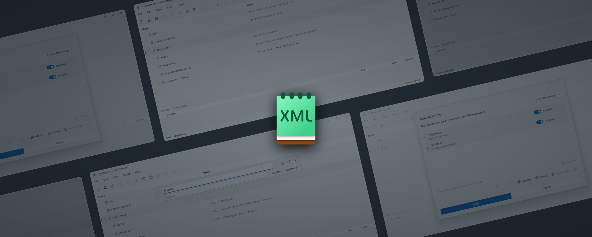

# XML Notepad



XML Notepad is a Windows editor for browsing and editing XML as a tree. Expand an element to see its children, edit a value in place, or move an entire branch.

## Install

### WinGet

Open PowerShell or Windows Terminal and run the install command.

```powershell
winget install --exact --id Microsoft.XMLNotepad
```

Use this command to update a copy installed with WinGet.

```powershell
winget upgrade --exact --id Microsoft.XMLNotepad
```

### Download an installer

Download the XML Notepad `.msixbundle` from [GitHub Releases](https://github.com/microsoft/XmlNotepad/releases/latest) and open it with Windows App Installer. Once installed, open **XML Notepad** from the Start menu.

### Offline install

Download `XmlNotepadSetup.zip` from [GitHub Releases](https://github.com/microsoft/XmlNotepad/releases/latest), copy it to the target PC, and extract it. Run `XmlNotepadSetup.msi` from the extracted folder.

### Portable build

Build the portable edition from the repository root.

```powershell
.\tools\publish.ps1 -Target Portable -Architecture x64
```

Run `XmlNotepad.exe` from `artifacts/portable/win-x64`. Keep the whole folder together when copying it to another PC. Use `-Architecture arm64` or `-Architecture x86` for those builds.

See the [installation guide](https://microsoft.github.io/XmlNotepad/install/) for WebView2 and file associations.

## What you can do

- Find and replace text, match a regular expression, or select nodes with XPath. [Find and Replace](https://microsoft.github.io/XmlNotepad/help/find/)
- Validate against an XSD as you edit and get suggestions for element names, attributes, and values. [Manage schemas](https://microsoft.github.io/XmlNotepad/help/schemas/)
- Compare two XML files, preview an XSLT transformation, or open CSV, JSON, and HTML as XML. [Menu reference](https://microsoft.github.io/XmlNotepad/help/menus/)

New to the editor? Open a bundled document from **Help > Open sample** and follow the [getting-started guide](https://microsoft.github.io/XmlNotepad/help/overview/).

## Build from source

The editor uses WinUI 3 and .NET 11. The [developer guide](https://microsoft.github.io/XmlNotepad/dev/) covers prerequisites, running tests, and building installers.

Report bugs or suggest improvements in [GitHub Issues](https://github.com/microsoft/XmlNotepad/issues).

[Code of conduct](https://opensource.microsoft.com/codeofconduct/) · [Report a security issue](https://msrc.microsoft.com/create-report)
